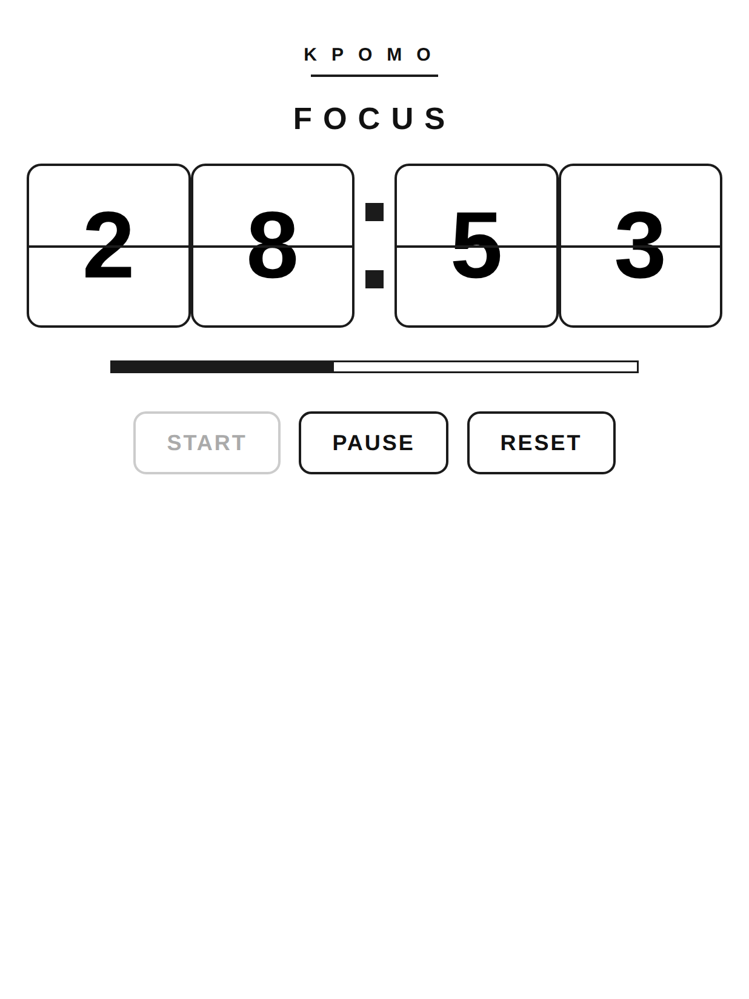
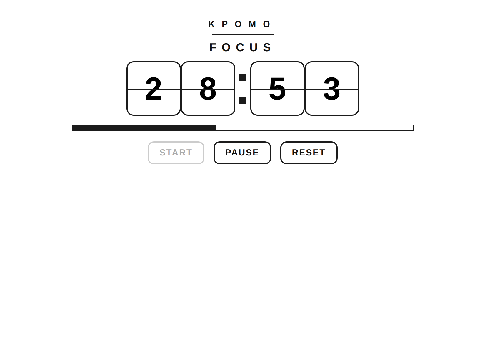
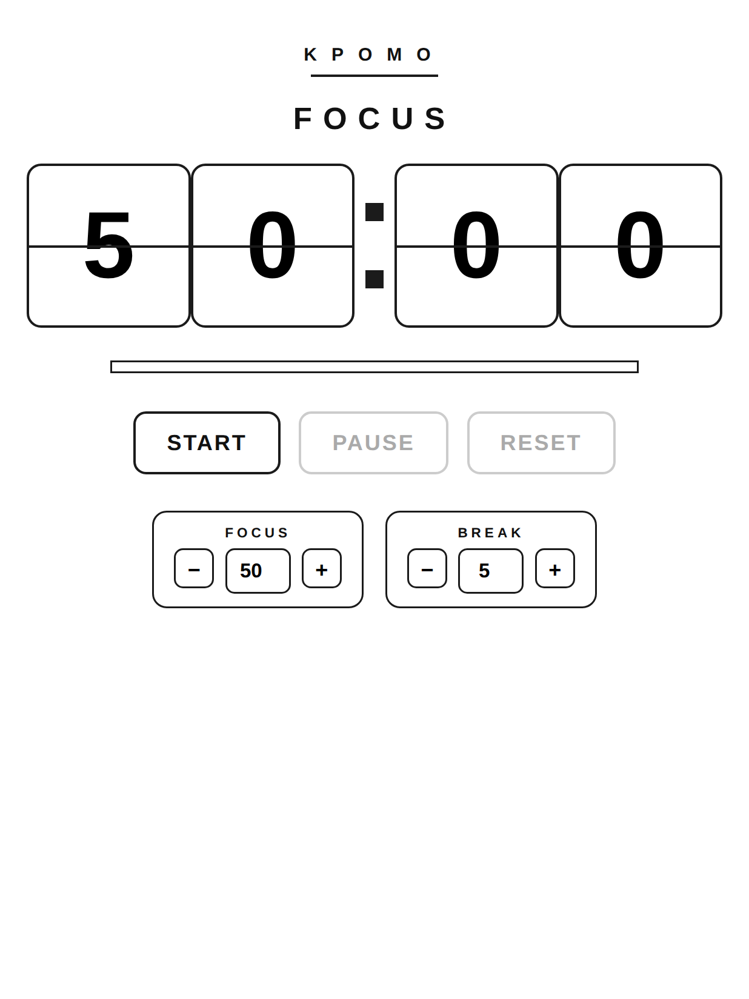

# Kpomo-fancy

**A split-flap flip-clock Pomodoro timer for Kindle.**

<p align="center">
  
  
</p>

> **If you find Kpomo-fancy useful, please give it a ⭐ star!**
> Stars help other Kindle tinkerers discover this project — and they're free.
> Bookmark the repo, share it in the [KindleModding Discord](https://discord.kindlemodding.org),
> or [buy me a coffee](https://ko-fi.com/lujunli) if it made you more productive. Thanks! 🙏

<a href="https://ko-fi.com/lujunli" target="_blank">
  
</a>

## Overview

- **Split-flap flip clock** — large white digit cards with a hinge seam across the middle,
  square-dot colon, and a bold poster wordmark. Tuned for e-ink: no animation, no shadows,
  no gradients — crisp and ghost-free
- **50 / 5 by default** — 50-minute focus sessions, 5-minute breaks (adjustable in the UI)
- **Manual advance** — when a session ends the timer *stops*; the mode label flips to the
  next session and you press Start when you're ready. No auto-start
- **Visual end cue** — a full-screen black "poster" flash + message. Deliberately no audio:
  Kindle WebKit audio is unreliable, so the cue is always visible and never fails
- **Fullscreen** — the chrome/status bar is hidden; the timer fills the screen
- **No screensaver / lock** — the screen stays awake while Kpomo-fancy runs
- **Portrait & landscape** — orientation-aware layout, flip the Kindle however you like
- **Zero dependencies** — plain HTML, CSS and vanilla JavaScript, written for Kindle's
  old WebKit (CSS 2.1 layout only, no flexbox)
- Installs as a Kindle booklet using the same packaging pattern as
  [KWordle](https://github.com/crizmo/KWordle)

## Gallery

| Idle | End-of-session cue |
|---|---|
|  |  |

*(Renders above are at real Kindle Paperwhite 5 resolution: 1236×1648.)*

## How to Install

> Requires a jailbroken Kindle. Tested on Paperwhite 5 (FW 5.16.9); should work on any
> device with the browser-based mesquite runtime (Kobo-free Kindles, FW ≥ 5.x).

1. Download the latest `Kpomo-fancy.zip` from the [releases page](../../releases).
2. Connect your Kindle via USB and copy the unzipped `kpomo-fancy` folder **and**
   `kpomo-fancy.sh` into the **documents** folder.
3. Safely eject, open the terminal (e.g. via `;debugOn` → `~bash`), and run:
   ```
   sh /mnt/us/documents/kpomo-fancy.sh
   ```
4. The app registers and launches. A **Kpomo-fancy** tile (flip-clock icon) now appears
   in the applications menu.

## Usage

1. Set durations with the **Focus / Break** cards (default 50 / 5 minutes).
2. Tap **Start** — settings hide and the countdown runs on the flip clock.
3. When a session ends, the screen flashes and a full-screen message appears
   (e.g. *BREAK TIME*). The timer stops; tap **Start** again to begin the next
   session — at your pace, never automatically.
4. **Pause** freezes the countdown; **Reset** returns to the session length.

## Fullscreen, orientation & keeping the screen awake

- **Fullscreen**: the app sets the chrome bar to `blank`
  (`configureChrome ... topNavBar:{template:"blank"}`).
- **Orientation**: the installer registers both orientations; CSS switches tile sizes via
  an `@media (orientation: landscape)` rule.
- **Screensaver**: the app runs `preventScreenSaver 1` while active. To restore it:
  `lipc-set-prop com.lab126.powerd preventScreenSaver 0`.
  (On FW ≥ 5.14.2 the old `~ds` trick is gone; an empty `TESTD_PREVENT_SCREENSAVER` file
  in the Kindle root works too.)

## Development

Everything lives in `kpomo-fancy/`: `main.js` (logic), `main.css` (styling),
`index.html` (structure), `config.xml` (booklet registration + chrome).
The technical app ID is `xyz.kurizu.kpomo`. Contributions and feedback welcome —
open an issue or a PR!

## Why "fancy"?

This is the polished redesign of **KPomo**: bigger bolder digit cards with the classic
split-flap seam, a poster-style wordmark, a proper progress gauge, a black primary
button, and a full-screen end-of-session poster. The original minimal `kpomo/` build
is still in this repo if you prefer the stripped-down look.
